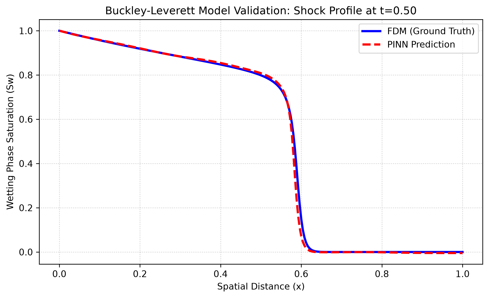
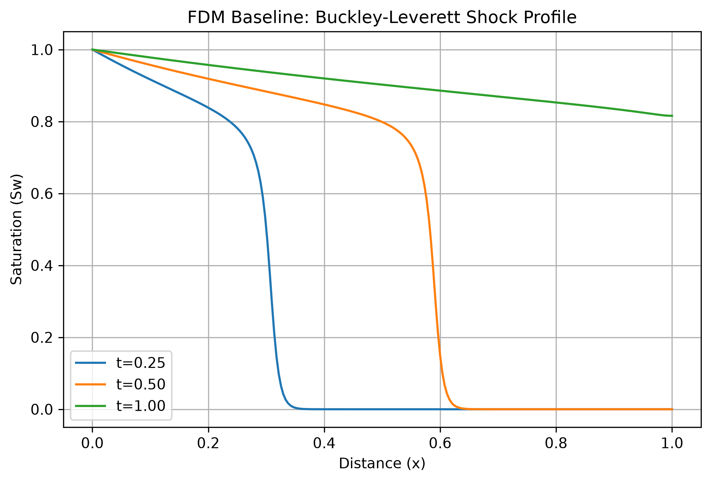

# Physics-Informed Neural Network (PINN) for 1D Buckley-Leverett Flow

[Link to Live PINN Application 🚀](YOUR_LINK_HERE)

<p align="center">

</p>

This project implements a Physics-Informed Neural Network (PINN) designed to predict two-phase immiscible fluid displacement in a 1D porous medium. By leveraging PyTorch's `autograd`, the computational model minimizes the nonlinear Buckley-Leverett partial differential equation (PDE) residual to capture the steep advection shock front and capillary diffusion physics. The **surrogate model achieves a global relative L₂ error of 2.72%**, providing a continuous, mesh-free system for real-time spatial saturation profiling without the computational overhead required by conventional numerical methods.

## 📌 Project Overview

Modeling multiphase fluid flow through porous media is a foundational challenge in reservoir engineering and environmental fluid dynamics. Standard numerical solvers, such as the Finite Difference Method (FDM), are bound to discrete grids and suffer from numerical dispersion or truncation errors when resolving steep discontinuities like advection shocks.

This project overcomes these limitations by utilizing a PINN that directly embeds the physical conservation laws into the neural network's loss function. This physics-driven optimization ensures predictions remain physically consistent and continuous, eliminating the need for expensive, labeled interior simulation data.

## 🛠️ Technology Used

- **Deep Learning & Autograd:** PyTorch
- **Scientific Computing:** NumPy
- **Visualization:** Matplotlib
- **Mathematical Validation:** Finite Difference Method (FDM) Baseline

## 🔳 Key Features

- **Physics-Informed Architecture:** A fully connected 4-hidden-layer network (50 neurons each) utilizing the **SiLU (Swish)** activation function to inherently mitigate spectral bias and accurately capture sharp gradients.
- **Targeted Collocation Strategy:** Evaluates the interior physics loss ($L_{PDE}$) over **20,000 unsupervised points**—combining 10,000 uniform domain points with 10,000 points explicitly targeted along the theoretical shock trajectory to blanket the steep gradient zone.
- **Sequential Optimization:** Features a two-phase optimization regime utilizing **Adam** for rapid loss landscape navigation (4,000 epochs) and **L-BFGS** for high-precision fine-tuning of the PDE residual (2,500 iterations).
- **High-Fidelity FDM Validation:** Synthesizes a ground-truth benchmark using an Explicit Forward-Time Central-Space (FTCS) finite difference solver augmented with an Upwind Advection scheme on a $256 \times 4000$ grid.

## 📁 Repository Structure

<pre>
├── app
│   └── streamlit_app.py
├── models
│   └── pinn_trained.pt
├── notebooks
│   ├── fdm_baseline.ipynb
│   └── train_evaluate.ipynb
├── results
│   ├── fdm_baseline_evolution.png
│   └── validation_shock_profile.png
├── utils
│   └── pinn_model.py
├── README.md
└── requirements.txt
</pre>

## 🚀 Getting Started

### 1. Clone the Repository

```bash
git clone https://github.com/Oluwatobi-coder/1D-Buckley-Leverett-PINN.git
cd 1D-Buckley-Leverett-PINN
```

### 2. Install Dependencies

```bash
pip install -r requirements.txt
```

### 3. Generate the FDM Baseline

Open and execute the cells in `notebooks/fdm_baseline.ipynb` to compute the numerical ground truth and visualize the shock profile evolution.

<p align="center">

</p>


### 4. Train and Evaluate the PINN

- Open and execute the cells in `notebooks/train_evaluate.ipynb`. This will:
- Generate the boundary, initial, and targeted collocation points.
- Run the Adam and L-BFGS sequential optimization.
- Compute the relative L₂ error against the FDM baseline.
- Export the optimized `.pt` model weights to the `models/` directory.

### 5. Run the App

```bash
streamlit run app/streamlit_app.py
```

## 📊 Results
The optimization strategy successfully anchored the boundary conditions and minimized the physical loss without relying on labeled interior points.

| Parameter | Value |
| :--- | :--- |
| **Final Composite Loss (Adam + L-BFGS)** | 0.009787 |
| **Global Relative L₂ Error (vs. FDM Baseline)** | 2.72% |
| **Inference Domain** | Continuous |
| **Data Dependency** | No labeled interior points required |

### Performance Insights

- **Gradient Resolution:** The SiLU activation function and targeted collocation scheme successfully maintained physical conservation laws, resolving the advection shock without spatial truncation artifacts or non-physical oscillations.
- **Computational Efficiency:** Once trained, the surrogate model generates real-time predictions across any spatiotemporal coordinate in a single forward pass.

## 🤝 Contributing

Contributions are welcome! Potential improvements include:
- Expanding the spatial domain to 2D for heterogeneous permeability fields.
- Implementing Adaptive Activation Functions (AAFs) to further accelerate L-BFGS convergence.

## 📚 References

- Raissi, M., Perdikaris, P., & Karniadakis, G. E. (2019). Physics-informed neural networks: A deep learning framework for solving forward and inverse problems involving nonlinear partial differential equations. Journal of Computational Physics, 378, 686-707.

- Buckley, S. E., & Leverett, M. C. (1942). Mechanism of fluid displacement in sands. Transactions of the AIME, 146(01), 107-116.


## 📜 License

This project is licensed under the MIT License - see the `LICENSE` file for details.